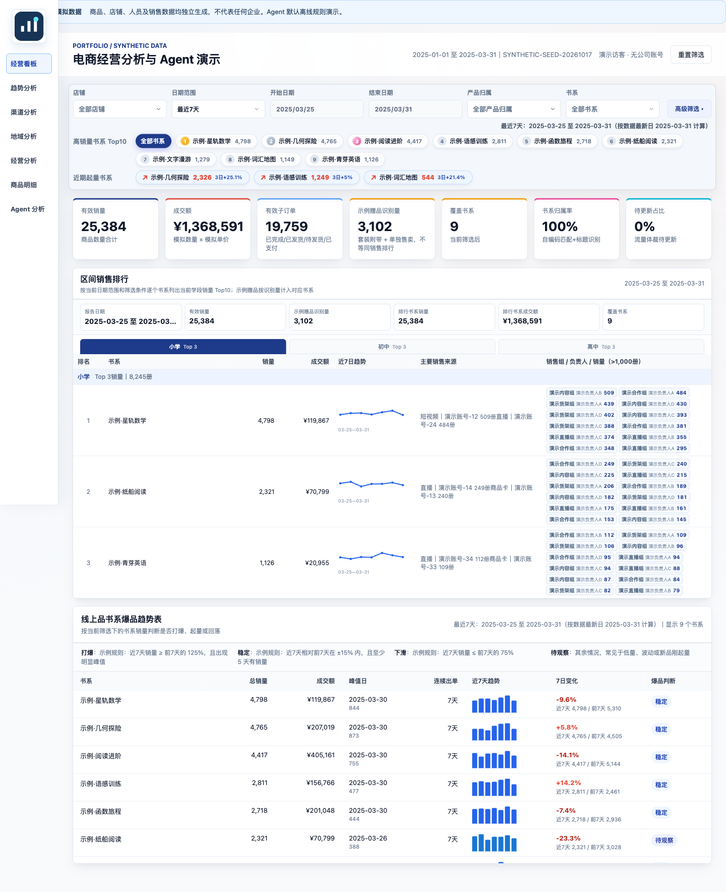
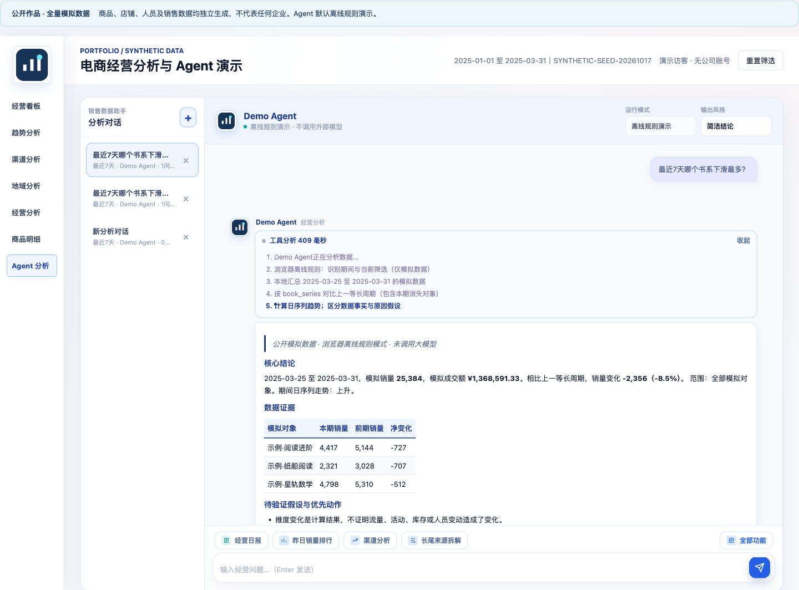

# 电商经营分析与 Agent 展示项目

面向管理者的销售分析看板，展示从业务指标、多维下钻到 Agent 分析的完整交互。页面保留了销售趋势、渠道贡献、负责人矩阵、销量流向、地域下钻、价格带、售后及数据核对能力。

**本仓库的全部业务数据均为独立生成的模拟数据。** 商品、店铺、负责人、账号、交易数量、金额与售后状态均为虚构；没有保留公司原始数据、真实分布、账号映射或历史记录。地图是通用行政区划底图，不是客户位置明细。

## 面向什么问题

管理者需要及时看清哪些产品、渠道和负责人推动或拖累销售，并把总览数字追溯到具体对象。这个作品用统一指标、多维筛选、趋势比较和带数据证据的问数流程，演示从“看数据”到“安排核查与销售动作”的路径。

本人负责业务需求、指标口径、分析流程、界面与验收设计，并借助 AI 完成代码开发、测试和部署整理。公开版用独立模拟数据重建业务场景；不披露原公司的销量、人员、客户或内部经营策略。

## 界面预览

以下截图全部来自本仓库的模拟数据。





## 本地运行

需要 Python 3.10 或更新版本。默认模式只用 Python 标准库，无须安装依赖、配置账号或模型密钥。

```bash
python3 scripts/serve_demo.py
```

Windows 可使用 `python scripts/serve_demo.py`，或双击 `start_demo.bat`。macOS 可运行 `bash start_demo.command`。浏览器访问：

```text
http://127.0.0.1:8765
```

结束时在终端按 Ctrl+C。Python 服务默认仅监听本机。也可以使用下方的静态导出，在 GitHub Pages 展示看板和浏览器离线分析。

## 看板与 Agent 如何展示

1. 在经营看板切换日期、产品、店铺和负责人，观察指标与图表联动。
2. 在趋势和渠道页面查看增长、下降及来源贡献，在地域页面点击省份下钻城市。
3. 打开「Agent 分析」，点击经营日报、周期对比、下滑归因、增长机会或渠道分析；也可输入「最近7天哪个书系下滑最多？」。
4. 展开「查看分析过程」，查看范围识别、汇总、周期对比、趋势工具的实际调用步骤。
5. 尝试筛选一个学段、店铺或产品后继续提问，确认回答沿用相应范围。

Agent 将输出组织为核心结论、数据证据、待验证假设和优先动作。销量/金额/增减均由模拟数据库实时计算，不使用预写的经营数字；原因假设和负责人安排不会被冒充成已确认事实。浏览器对话只保存在本机该站点的独立命名空间，仓库不预置历史对话。

### 默认离线规则模式

天气、旅游、新闻等无关问题会在分析前明确拒答，不执行数据工具；可选 LLM 模式也先检查当前问题范围，不因历史对话而绕过。当前采用范围词与无关主题规则，复杂表达仍需后续评测。

默认通过确定性规则识别常见分析意图，执行只读工具，流式展示结果与过程。**这是可操作的 Agent 工作流演示，不是大模型自主推理效果展示。** 不发送数据到外部服务，不需要公司接口或密钥。模拟日期固定在 2025-01-01 至 2025-03-31；相对日期以数据最新完整日为锚点。

### 可选 LLM 工具调用模式

代码同时提供 OpenAI 兼容接口的多轮工具调用适配层。使用者自行选择提供商、填写环境变量，然后显式开启：

```bash
export DEMO_LLM_API_KEY='填写你自己的密钥'
export DEMO_LLM_BASE_URL='填写提供商的兼容接口地址，包含 /v1 等所需路径'
export DEMO_LLM_MODEL='填写提供商支持的模型名称'
python3 scripts/serve_demo.py --llm
```

`.env.example` 只是字段说明，服务不会自动加载它或父目录的任何 `.env`。开启 LLM 模式后，问题、所选范围和模拟查询结果会发送至自行配置的提供商。密钥只从本机环境读取，不进入前端或错误响应。外部模型模式需要使用者配置后验证，本交付没有使用任何公司密钥测试。

支持的工具：`get_data_schema`、`get_summary_stats`、`compare_segments`、`drill_down`、`analyze_trend`、`run_sql_query`。页面维度条件先在独立临时库中限定，工具只能读取该模拟范围；单次对话最多 6 轮工具调用。写库、采购和修改业务记录均不在工具范围内。

## 在线展示与 GitHub Pages

```bash
python3 scripts/build_static.py
python3 -m http.server 8766 --bind 127.0.0.1 --directory site
```

打开 `http://127.0.0.1:8766/`。导出的 `site/` 仅包含前端、第三方库、通用地图与模拟 JSON，不包含 SQLite 原文件、Python 服务或密钥。支持仓库子路径。不要通过双击 HTML 打开，浏览器需要 HTTP 服务加载 JSON。

仓库已提供 `.github/workflows/pages.yml`：推送 `main` 后先检查数据、运行回归测试，再构建静态站点。首次发布需在 GitHub 仓库 **Settings → Pages → Source** 选择 **GitHub Actions**。之后可在 Actions 查看部署结果。仅工作流构建的 `site/` 进入网站，不会托管上级文件夹。

静态站点的 Agent 在浏览器中进行确定性汇总、周期对比和趋势分析，展示工具过程；不连接大模型、不执行自由 SQL。Python 模式额外支持六类只读工具、MCP 与自行配置的 LLM 工具调用。静态与 Python 聚合使用相同模拟数据，并通过 SQLite 对照测试核对。

## MCP 可选入口

如需在支持 MCP 的客户端演示同一分析工具集：

```bash
python3 -m pip install -r requirements-mcp.txt
python3 scripts/mcp_server.py
```

MCP 默认数据库也是本仓库生成的模拟库。启动信息输出到 stderr，避免污染 stdio 协议。它仅用于演示工具接入，不包含任何原生产配置。

## 数据生成与核对

```bash
python3 scripts/generate_demo_data.py
python3 scripts/check_public_data.py
```

数据生成器只使用仓库内的虚构目录、固定随机种子和人工设计的增长/下降/平稳场景，不会访问旧项目、工作电脑目录或外部数据源。可以检查 `web/data/provenance.json` 查看来源说明。模拟成交额口径为模拟数量乘模拟单价；没有广告费用数据，因此不计算 ROI。

## 验证

```bash
python3 -m unittest discover -s tests -v
python3 scripts/check_public_data.py
```

分析回归检查包括：前期有而本期消失的商品、自然周、成交额与销量口径、只读限制、筛选范围约束，以及模型未查询数据时拒绝输出经营结论。安装 Node.js 后，会额外对照浏览器静态聚合与 SQLite 的多维结果；GitHub Actions 配有 Node.js，运行完整检查。真实模型的回答质量与提效仍需要单独评测。

## 目录

```text
web/                         看板、交互、图表与通用底图
web/data/dashboard.db        从零生成的 SQLite 模拟库
web/data/provenance.json     数据来源与生成方式说明
scripts/generate_demo_data.py 独立模拟数据生成器
scripts/dashboard_queries.py 多维筛选与 SQL 汇总
scripts/analytics_engine.py  共享分析工具引擎
scripts/demo_agent.py        离线流程与可选 LLM 工具调用
scripts/serve_demo.py        本地演示服务
scripts/mcp_server.py        可选 MCP 工具入口
scripts/build_static.py      GitHub Pages 静态导出
web/static-runtime.js        浏览器离线聚合与分析
tests/                      SQLite、Agent 和静态模式回归检查
.github/workflows/pages.yml  校验、构建、托管工作流
docs/                       数据处理说明和项目架构
```

本项目展示业务理解、指标定义、数据产品设计、可视化和 AI 协作交付。它是从实际业务项目框架整理的独立演示，模拟数据上的结果不代表原企业经营结果，也不用于声称线上模型准确率或量化提效。

## 上传范围

仅上传本目录，或使用随附的展示版 ZIP。不要从包含原项目、原始压缩包和其他工作文件的上级目录执行 `git add .`。本目录没有旧 Git 历史，不包含生产数据库、员工账号、企业图片、密钥、原始导出、日志或历史截图。

第三方库及地理底图来源见 `THIRD_PARTY_NOTICES.md`。源码授权方式可由仓库所有者在发布前自行确定。
